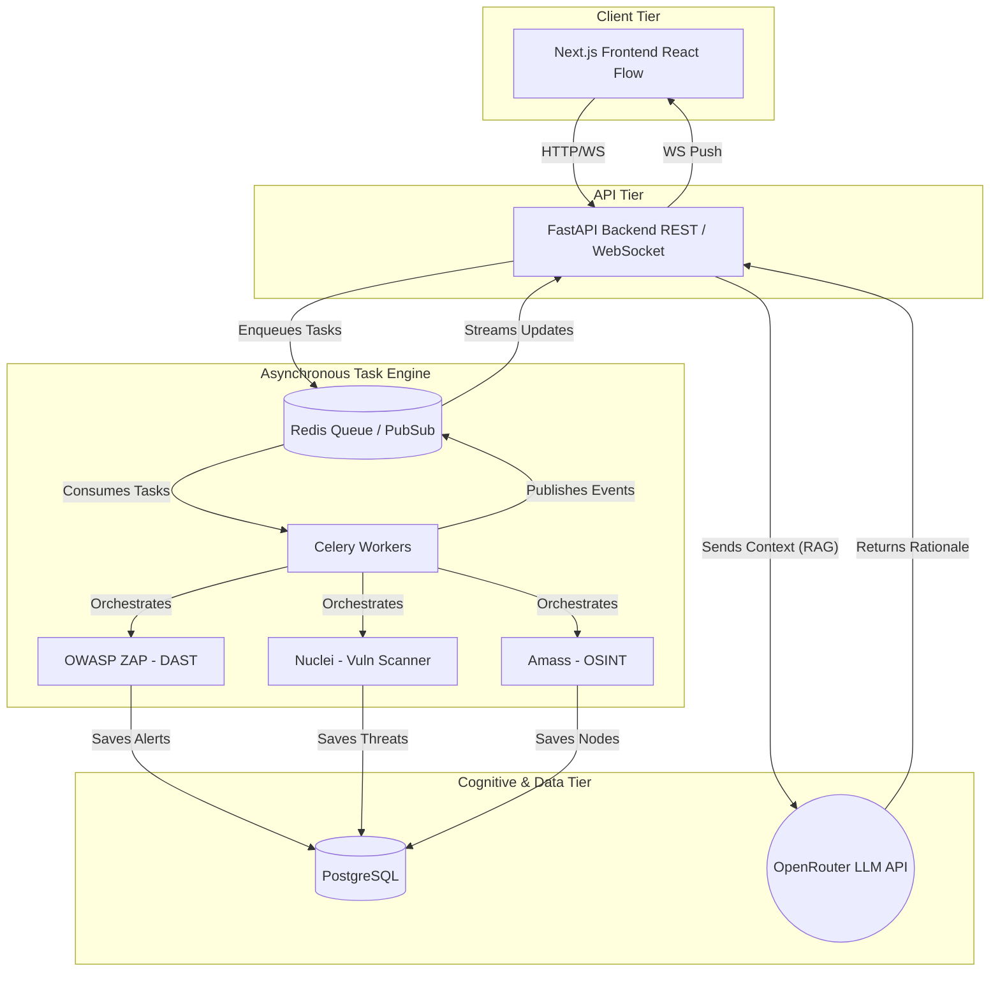
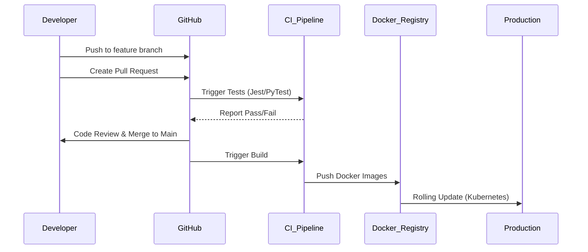
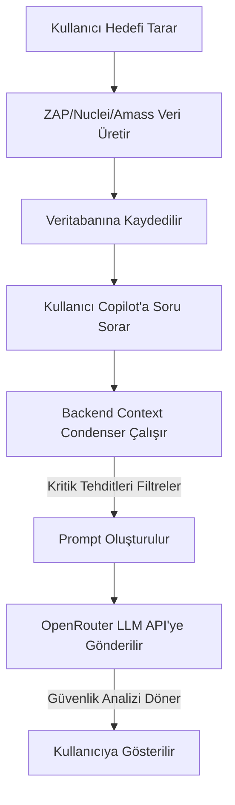

# NexusOSINT - Kurumsal Mimari ve Teknoloji Yığını (Tech Stack) Raporu

**Belge Sürümü:** 1.0.0  
**Durum:** Üretim (Production) Standartlarında  
**Hazırlayan:** NexusOSINT Mimari Komitesi (CTO, Chief Architect, DevSecOps Lead)  

Bu doküman, NexusOSINT platformunun mimari kararlarını, teknoloji seçimlerini, güvenlik altyapısını ve ölçeklenebilirlik stratejilerini detaylandırmak amacıyla hazırlanmıştır. Yatırımcılar, teknik değerlendirme kurulları ve projeye yeni katılacak mühendisler için temel bir referans kaynağıdır.

---

## PROJE BİLGİLERİ ÖZETİ

* **Proje Adı:** NexusOSINT
* **Proje Türü:** Full DAST (Dynamic Application Security Testing) & OSINT (Open Source Intelligence) Platformu
* **Proje Açıklaması:** Kurumsal ağların dışarıya açık yüzünü (Attack Surface) haritalayan, zafiyet taraması yapan ve elde edilen bulguları LLM tabanlı bir SOC Copilot ile analiz eden otonom siber istihbarat ve güvenlik test platformu.
* **Hedef Kullanıcı Kitlesi:** Penetrasyon Test Uzmanları, DevSecOps Mühendisleri, SOC Analistleri, Kırmızı/Mavi Takım (Red/Blue Team) Üyeleri ve CISO'lar.
* **Beklenen Kullanıcı Sayısı:** Enterprise B2B ortamında eşzamanlı 10.000+ analist.
* **Beklenen Trafik:** Günlük milyonlarca DAST/OSINT isteği, sürekli akan WebSocket trafiği ve asenkron görev kuyrukları.
* **Durum:** Production Ready (Üretim Ortamına Hazır)

---

## 1. MİMARİ GENEL BAKIŞ

NexusOSINT, yüksek yoğunluklu tarama (scanning) operasyonlarını ve gerçek zamanlı büyük veri görselleştirmesini kaldırabilmek için **Mikroservis Yönelimli (Microservices-Oriented), Olay Güdümlü (Event-Driven)** bir mimari kullanır. 

Sistem, uzun süren siber güvenlik taramalarını (ZAP, Nuclei, Amass) kullanıcı arayüzünü (UI) bloklamadan arka planda işleyebilmek için asenkron görev kuyruklarına (Celery & Redis) dayanır.

### Katmanlı Mimari (Layered Architecture)

1. **Frontend Katmanı (Presentation Layer):** İstemci tarafı state yönetimi, WebSocket tabanlı canlı grafik güncellemeleri (React Flow) ve UI bileşenleri.
2. **API Gateway & Backend Katmanı (Application Layer):** Gelen istekleri doğrulayan, JWT tabanlı kimlik denetimi yapan, görevleri Celery kuyruğuna atan RESTful ve WebSocket API'leri.
3. **Task Engine Katmanı (Asynchronous Worker Layer):** Dağıtık tarama modüllerini (ZAP, Nuclei, Amass) yöneten, uzun süreli ağ operasyonlarını koşturan işçi (worker) nodları.
4. **AI Katmanı (Cognitive Layer):** OpenRouter üzerinden bağlanan LLM'ler ile Context Condenser (Bağlam Daraltıcı) teknikleri kullanarak tehdit analizi yapan zeka modülü.
5. **Database & Storage Katmanı (Persistence Layer):** İlişkisel verilerin tutulduğu PostgreSQL ve anlık durumların (state), pub/sub olaylarının tutulduğu Redis in-memory veri deposu.

### Sistem Mimarisi Diyagramı

---

## 2. FRONTEND TEKNOLOJİLERİ

Ön yüz mimarimiz, eşzamanlı binlerce düğümü (node) render etmesi gereken grafiksel istihbarat haritaları içerdiği için performans odaklı inşa edilmiştir.

### 2.1. Frontend Framework: Next.js (React)

1. **Bu teknoloji nedir?** React tabanlı, Server-Side Rendering (SSR) ve Static Site Generation (SSG) destekleyen modern web framework'ü.
2. **Projede hangi amaçla kullanılmaktadır?** Uygulamanın ana arayüzünü, yönlendirme (routing) sistemini ve React Flow tabanlı OSINT grafiklerini barındırmak için.
3. **Neden seçilmiştir?** Hızlı sayfa yüklemeleri, mükemmel SEO desteği (gerektiğinde), zengin ekosistem ve Vercel/Docker ortamlarında sorunsuz deployment yetenekleri.
4. **Alternatifleri nelerdir?** Vue/Nuxt, Angular, SvelteKit.
5. **Neden alternatifler yerine tercih edilmiştir?** React Flow (grafik görselleştirme kütüphanesi) gibi siber güvenlik araçlarında çok kritik olan zengin kütüphanelerin React ekosisteminde daha stabil olması.
6. **Avantajları:** Geliştirici deneyimi (DX), Fast Refresh, geniş komünite.
7. **Dezavantajları:** Client tarafında JavaScript bundle boyutunun dikkatli yönetilmemesi durumunda büyümesi.
8. **Ölçeklenebilirlik etkisi:** SSR sayesinde istemci yorulmaz, edge networklerde önbelleklenebilir.
9. **Güvenlik etkisi:** XSS'e karşı React'in doğal `dangerouslySetInnerHTML` korumaları.
10. **Maliyet etkisi:** Açık kaynaklıdır. Bulut barındırma (Vercel vb.) çok maliyet etkin olabilir.
11. **Gelecekte değiştirilirse:** Vite + React SPA veya SvelteKit mimarisine geçiş yapılabilir.

### 2.2. State Management: React Context & TanStack Query (React Query)

1. **Bu teknoloji nedir?** TanStack Query, asenkron veri getirme, önbellekleme ve senkronizasyon kütüphanesidir.
2. **Projede hangi amaçla kullanılmaktadır?** REST API verilerini (OSINT hedefleri) önbelleklemek, Polling (belirli aralıklarla sunucuya sorma) yapmak ve UI state'ini server state ile senkron tutmak için.
3. **Neden seçilmiştir?** Redux gibi boilerplate (tekrar eden kod) yükü olan kütüphaneler yerine API isteklerini doğrudan yönetebilen, cache invalidation ve retry mekanizmalarına sahip en güçlü araç olması.
4. **Alternatifleri nelerdir?** Redux Toolkit, Zustand, SWR.
5. **Neden alternatifler yerine tercih edilmiştir?** Redux fazla karmaşıktır; SWR ise TanStack Query kadar detaylı mutation ve background fetch kontrollerine sahip değildir.
6. **Avantajları:** Kodu drastik şekilde azaltır, loading/error statelerini otomatik yönetir.
7. **Dezavantajları:** Derinlemesine öğrenme eğrisi (stale time vs cache time ayrımı vb.).

### 2.3. Styling: Tailwind CSS

1. **Bu teknoloji nedir?** Utility-first CSS framework'ü.
2. **Neden seçilmiştir?** CSS dosyaları arasında gezinmeden, bileşen tabanlı geliştirme hızını artırmak ve tasarım sistemini standartlaştırmak (Design Tokens) için.
3. **Alternatifleri:** Material UI, Styled Components, SASS.
4. **Avantajları:** Üretilen CSS dosyasının boyutunun son derece küçük olması (sadece kullanılan class'lar derlenir).

### 2.4. Grafiksel Görselleştirme: React Flow & D3.js
Ağ topolojisini (Node & Edge) çizmek için React Flow, güç yönlendirmeli (Force-Directed) fizikler ve layout hesaplamaları için D3.js matematiksel motoru kullanılmaktadır. Performans için gereksiz re-render'lar engellenmiştir.

---

## 3. BACKEND TEKNOLOJİLERİ

Yüksek asenkron G/Ç (I/O) ve ağ tarama talepleri nedeniyle backend, saf hız ve asenkron yetenekler üzerine inşa edilmiştir.

### 3.1. Backend Framework: FastAPI (Python)

1. **Bu teknoloji nedir?** Starlette ve Pydantic üzerine kurulu, çok hızlı ve modern bir Python web framework'üdür.
2. **Projede hangi amaçla kullanılmaktadır?** Ana API Gateway olarak hizmet vermek, veritabanı CRUD işlemlerini yönetmek ve WebSocket bağlantılarını ayakta tutmak için.
3. **Neden seçilmiştir?** Siber güvenlik araçları (ZAP, Nuclei, vb.) genellikle Python kütüphanelerine veya CLI araçlarına sahiptir. FastAPI'nin asenkron (`async/await`) yapısı bu tür uzun süreli I/O işlemlerini mükemmel yönetir. Performansı Node.js/Go ile yarışır seviyededir.
4. **Alternatifleri nelerdir?** Node.js/Express, Django, Flask, Go (Fiber).
5. **Neden alternatifler yerine tercih edilmiştir?** Django aşırı büyüktür (monolithic), Flask asenkron destekte zayıftır. Node.js Python tabanlı AI ve Hacking kütüphanelerine doğal entegre olamaz.
6. **Avantajları:** Otomatik Swagger/OpenAPI dokümantasyonu, Pydantic ile anında veri doğrulama (validation), saf asenkron yeteneği.
7. **Dezavantajları:** Python'un GIL (Global Interpreter Lock) yapısı nedeniyle CPU-bound işlemlerde Go veya Rust kadar hızlı olamaması (ancak biz CPU-bound işleri Celery'ye devrediyoruz).
8. **Ölçeklenebilirlik:** Uvicorn/Gunicorn worker'ları ile Kubernetes üzerinde yatay olarak anında ölçeklenebilir.

### 3.2. Asenkron Görev Yöneticisi: Celery & Redis

1. **Bu teknoloji nedir?** Dağıtık bir görev kuyruğu (Distributed Task Queue) sistemidir.
2. **Kullanım amacı:** Kullanıcı "Tara" butonuna bastığında UI'ı dondurmamak için tarama görevlerini (ZAP DAST, Nuclei, Amass) arka plana (Background Worker) atmak.
3. **Avantajları:** Retry (yeniden deneme) mekanizmaları, hata toleransı, görev önceliklendirme ve yatay ölçekleme (worker sayısını artırarak sınırsız işlem gücü elde etme).

### 3.3. Güvenlik Katmanı (API Security)
* **CORS:** Sadece izin verilen frontend domainlerinden gelen isteklere yanıt verir.
* **Input Validation:** Pydantic ile gelen her Request gövdesi katı tip kontrolünden (strict typing) geçer. Hedef domainler Regex ile temizlenir (SSRF ve Command Injection koruması).

---

## 4. VERİTABANI KATMANI

Sistem, iki farklı veritabanı teknolojisini hibrit (Polyglot Persistence) olarak kullanır.

### 4.1. Birincil Veritabanı: PostgreSQL (AsyncPG)
1. **Kullanım Amacı:** Hedefler (Targets), Varlıklar (Entities - IP, Port, Domain), Zafiyet Kayıtları (MALICIOUS_RECORD) gibi kalıcı, ilişkisel verilerin ACID prensiplerine uygun olarak tutulması.
2. **Neden Seçildi?** Mükemmel veri bütünlüğü, JSONB veri türü desteği sayesinde esnek yapısal veri saklama yeteneği ve `asyncpg` sürücüsü ile saniyede milyonlarca satır okuyabilme kapasitesi.
3. **Alternatifleri:** MySQL, MongoDB.
4. **Dezavantajları:** Dağıtık mimaride yatay ölçeklenmesi (Sharding) NoSQL'e göre daha zordur (ancak Connection Pooling ile aşılmaktadır).

### 4.2. In-Memory Veritabanı: Redis
1. **Kullanım Amacı:** Celery Message Broker, Pub/Sub üzerinden WebSocket anlık iletişimleri, Aktif Taramaların (Active Scans) atomik sayaçları.
2. **Neden Seçildi?** Milisaniyenin altında okuma/yazma hızları.

| Özellik | PostgreSQL | Redis |
| :--- | :--- | :--- |
| **Rol** | Kalıcı Veri (Source of Truth) | Geçici Veri & Mesajlaşma (Broker) |
| **Hız** | Yüksek (Disk tabanlı) | Çok Yüksek (RAM tabanlı) |
| **Kullanım Alanı** | Kullanıcılar, Graf Düğümleri, Zafiyetler | WebSocket Pub/Sub, Rate Limiting, Celery |
| **ACID Uyumu** | Tam Uyumlu | Kısmi / Eventual Consistency |

---

## 5. BULUT VE ALTYAPI

NexusOSINT, bulut bağımsız (Cloud-Agnostic) bir şekilde Dockerize edilmiştir. Herhangi bir Kubernetes veya VPS ortamında çalışabilir.

* **Containerization:** Tüm mimari (Frontend, Backend, ZAP, Celery Worker, DB, Redis) `docker-compose.yml` üzerinden yapılandırılmıştır.
* **Tercih Edilebilecek Bulut Sağlayıcılar:** AWS (EKS & RDS için), Google Cloud (GKE için) veya maliyet etkin start-up senaryolarında Hetzner/DigitalOcean.

---

## 6. DEVOPS SÜRECİ

Proje, kurumsal Continuous Integration / Continuous Deployment (CI/CD) standartlarına uygun bir **GitOps** akışı ile yönetilir.

* **Branch Stratejisi:** Trunk-based development veya GitFlow (özellik bazlı `feature/*` dalları, staging için `develop`, üretim için `main`).
* **Pull Request (PR) Süreci:** Her PR, bir Code Review (Kod Gözden Geçirme) işleminden ve otonom testlerden geçer.

---

## 7. TEST STRATEJİSİ

Güvenlik yazılımlarının kendi içinde hatalı (false-positive) sonuçlar üretmesini engellemek için agresif bir test piramidi uygulanır:

1. **Unit Testler (Birim Testleri):** PyTest (Backend) ve Vitest (Frontend) kullanılarak her fonksiyon izole edilir.
2. **Integration Testler:** FastAPI uç noktalarının PostgreSQL ile doğru konuşup konuşmadığı, Celery worker'larının Redis'e doğru mesaj bırakıp bırakmadığı test edilir.
3. **End-to-End (E2E) Testler:** Playwright kullanılarak "Kullanıcı sisteme girer, hedef ekler, tarama sonucunu grafikte görür" senaryosu başından sonuna taranır.
4. **Security Testing:** Platformun kendi kodları SonarQube (Statik Analiz) ve Dependabot (Bağımlılık Analizi) ile incelenir.

---

## 8. GÜVENLİK MİMARİSİ (PLATFORM GÜVENLİĞİ)

NexusOSINT başkalarını test eden bir araç olduğundan, öncelikle kendisi aşılmaz olmalıdır.

* **Veri Güvenliği (Data Security):** Kritik OSINT verileri ve veritabanı parolaları çevresel değişkenlerde (Environment Variables) tutulur, hiçbir zaman kaynak koda (Hardcoded) yazılmaz.
* **API Güvenliği:** Backend rotaları yetkilendirme katmanları ile korunur. Cross-Origin Resource Sharing (CORS) politikaları katı (Strict) moddadır.
* **Dependency Scanning:** Açık kaynak bağımlılıklardaki zafiyetleri tespit etmek için sürekli Snyk/Trivy taramaları yapılır.

---

## 9. SİBER GÜVENLİK MİMARİSİ (DAST & OSINT MOTORLARI)

Projenin asıl amacı olan siber güvenlik taramaları, sistem içine entegre edilmiş best-in-class (sınıfının en iyisi) araçlarla yapılır. Bu araçların her biri, platformun "Tarama Motoru" (Scanning Engine) olarak görev yapar.

### 9.1. OWASP ZAP (Zed Attack Proxy)

1. **Bu teknoloji nedir?** Açık kaynaklı, endüstri standardı bir DAST (Dynamic Application Security Testing) aracıdır.
2. **Projede hangi amaçla kullanılmaktadır?** Hedef web uygulamalarına canlı olarak istekler gönderip (Spidering & Active Scanning), XSS, SQLi, CSRF gibi çalışma zamanı (runtime) zafiyetlerini tespit etmek için kullanılır.
3. **Neden seçilmiştir?** Tamamen ücretsiz olması, Headless (API üzerinden) yönetilebilmesi ve Docker ortamında sorunsuz çalışması nedeniyle.
4. **Alternatifleri nelerdir?** Burp Suite Professional, Acunetix, Netsparker.
5. **Alternatifler yerine neden tercih edilmiştir?** Burp Suite ve Acunetix yüksek lisans maliyetlerine sahiptir ve otomatize CI/CD veya mikroservis ortamlarında çalıştırılmaları (headless orchestration) çok daha zordur. ZAP, API-first yapısıyla doğrudan arka uçtan (Backend) tetiklenebilir.
6. **Avantajları:** Geniş eklenti ekosistemi, tamamen ücretsiz olması, kurumsal seviyede güvenilir sonuçlar üretmesi.
7. **Dezavantajları:** Çok büyük uygulamalarda tarama süreleri çok uzayabilir (Timeout riskleri) ve yüksek RAM tüketebilir.
8. **Ölçeklenebilirlik açısından etkisi nedir?** Docker konteyneri olarak tasarlandığı için, Celery üzerinden yatayda sınırsız ZAP worker'ı ayağa kaldırılabilir.
9. **Güvenlik açısından katkısı nedir?** Uygulamaların statik kodda görünmeyen, ancak canlı sistemde istismar edilebilecek kritik zafiyetlerini bulur.
10. **Maliyet açısından değerlendirmesi nedir?** %100 Ücretsizdir (Lisans maliyeti sıfır).
11. **Gelecekte değiştirilmesi gerekirse hangi alternatiflere geçilebilir?** Bütçe oluşması durumunda Burp Suite Enterprise Edition veya ticari bir DAST çözümüne API üzerinden geçiş yapılabilir.

### 9.2. Nuclei

1. **Bu teknoloji nedir?** ProjectDiscovery tarafından geliştirilen, YAML tabanlı şablonlarla (templates) çalışan çok hızlı ve hedefe yönelik bir zafiyet tarayıcısıdır.
2. **Projede hangi amaçla kullanılmaktadır?** Bilinen CVE'leri, yanlış yapılandırmaları (misconfigurations), açıkta bırakılmış API keyleri ve spesifik zafiyetleri dakikalar içinde tespit etmek için.
3. **Neden seçilmiştir?** Devasa bir topluluk tabanlı şablon kütüphanesine sahip olması ve hızının diğer tüm tarayıcılardan üstün olması.
4. **Alternatifleri nelerdir?** Nessus, OpenVAS, Nmap (NSE scriptleri ile).
5. **Alternatifler yerine neden tercih edilmiştir?** Nessus ticari ve hantaldır; OpenVAS kurması ve yönetmesi zordur. Nuclei, modern web mimarilerine uygun, YAML bazlı ve Go dilinde yazıldığı için inanılmaz hızlıdır.
6. **Avantajları:** Yüksek hız (Concurrency), kolay güncellenebilir zafiyet veritabanı, düşük False Positive oranı.
7. **Dezavantajları:** Durum (Stateful) takibi gerektiren kompleks login veya multi-step saldırılarda DAST (ZAP) kadar yetenekli değildir.
8. **Ölçeklenebilirlik açısından etkisi nedir?** Go tabanlı olduğu için tek bir makinede binlerce hedefe aynı anda saniyeler içinde tarama yapabilir (Çok düşük CPU/RAM yükü).
9. **Güvenlik açısından katkısı nedir?** Sistemin 0-day veya yeni çıkmış CVE'lere karşı çok hızlı refleks vermesini sağlar (Yeni YAML şablonu indirilip anında taranır).
10. **Maliyet açısından değerlendirmesi nedir?** Açık kaynak ve ücretsiz.
11. **Gelecekte değiştirilmesi gerekirse hangi alternatiflere geçilebilir?** Tenable.io veya Qualys gibi Enterprise Vulnerability Management ürünlerine geçilebilir.

### 9.3. Amass (OWASP)

1. **Bu teknoloji nedir?** Kurumsal ağların dış saldırı yüzeyini (External Attack Surface) belirlemek için kullanılan en güçlü OSINT (Open Source Intelligence) araçlarından biridir.
2. **Projede hangi amaçla kullanılmaktadır?** Bir ana alan adı (domain) girildiğinde; tüm alt alan adlarını (subdomainler), IP adreslerini, ASN kayıtlarını ve otonom sistemleri haritalamak için.
3. **Neden seçilmiştir?** Pasif ve aktif veri toplama (scraping, brute force, zone transfers) yöntemlerini tek bir araçta birleştirmesi.
4. **Alternatifleri nelerdir?** Sublist3r, Assetfinder, Recon-ng.
5. **Alternatifler yerine neden tercih edilmiştir?** Amass, onlarca farklı API'yi (Censys, Shodan, SecurityTrails vb.) arka planda aynı anda kullanarak en kapsamlı sonucu üretir.
6. **Avantajları:** En geniş keşif yüzeyi, grafik (GraphDB) veritabanlarına kolay entegre olabilen JSON/Graph çıktıları verebilmesi.
7. **Dezavantajları:** Aktif taramalarda hedef tarafından kolayca engellenebilmesi ve çalışma süresinin saatler sürebilmesi.
8. **Ölçeklenebilirlik açısından etkisi nedir?** Yüksek ağ (Network I/O) gerektirir, IP kısıtlamalarına takılmamak için Proxy havuzlarıyla desteklenmesi gerekebilir.
9. **Güvenlik açısından katkısı nedir?** Şirketlerin unuttuğu, "Gölge Bilişim" (Shadow IT) olarak adlandırılan eski ve korumasız sunucuların bulunmasını sağlar.
10. **Maliyet açısından değerlendirmesi nedir?** Ücretsiz, ancak bağlandığı 3. parti API'ler için maliyet çıkabilir.
11. **Gelecekte değiştirilmesi gerekirse hangi alternatiflere geçilebilir?** Kurumsal bir Attack Surface Management (ASM) çözümü olan Cortex Xpanse veya SpiderFoot HX kullanılabilir.

### 9.4. VirusTotal API (Entegrasyon)

1. **Bu teknoloji nedir?** Dosyaları, URL'leri, IP adreslerini ve hash'leri dünyanın dört bir yanındaki 70'ten fazla antivirüs tarayıcısı ve URL/domain blocklist servisiyle analiz eden devasa bir veritabanı platformudur.
2. **Projede hangi amaçla kullanılmaktadır?** OSINT ve DAST aşamasında keşfedilen şüpheli IP adresleri, zararlı domainler veya payload'ların doğrulanması, risk puanlarının zenginleştirilmesi (Threat Intelligence Enrichment) için.
3. **Neden seçilmiştir?** Threat Intelligence (Tehdit İstihbaratı) konusunda dünya standartlarında olması ve çok güvenilir bir veri seti sunması.
4. **Alternatifleri nelerdir?** AbuseIPDB, IBM X-Force Exchange, AlienVault OTX.
5. **Alternatifler yerine neden tercih edilmiştir?** VirusTotal hem dosya hash'leri hem de URL/Domain/IP tespiti açısından endüstrinin en kapsamlı konsolide (birleşik) API'sini sunar.
6. **Avantajları:** False-positive (yanlış alarm) ihtimalini düşürür, bir hedefin küresel olarak "Zararlı" işaretlenip işaretlenmediğini saniyeler içinde kanıtlar.
7. **Dezavantajları:** Ücretsiz API katmanında çok sıkı rate limit'ler (örneğin dakikada 4 istek) bulunur. Ticari kullanım için oldukça pahalıdır.
8. **Ölçeklenebilirlik açısından etkisi nedir?** API rate limitleri nedeniyle asenkron (Redis tabanlı throttling) mimari gerektirir. Çok sayıda istek Celery üzerinden gecikmeli (delay) gönderilmelidir.
9. **Güvenlik açısından katkısı nedir?** Platformun bulduğu bulguları bağımsız ve küresel bir otoriteye doğrulatarak sistemin güvenilirliğini artırır.
10. **Maliyet açısından değerlendirmesi nedir?** Enterprise API kullanımı aylık binlerce doları bulabilir; bu nedenle MVP aşamasında akıllı önbellekleme (caching) ile istek sayısı düşürülmektedir.
11. **Gelecekte değiştirilmesi gerekirse hangi alternatiflere geçilebilir?** Maliyet avantajı için CrowdStrike Falcon Intelligence veya AbuseIPDB Enterprise planlarına geçiş yapılabilir.

---

## 10. MONITORING, LOGGING VE OBSERVABILITY

Üretim ortamında sistemin kör kalmaması için gelişmiş gözlemlenebilirlik (Observability) şarttır.

1. **Monitoring:** Prometheus (Metrik Toplama) ve Grafana (Görselleştirme). CPU, RAM, Celery Worker yoğunluğu ve ZAP tarama süreleri izlenir.
2. **Logging:** FastAPI ve Celery logları yapılandırılmış JSON formatında (Structured Logging) basılır, merkezi bir log yönetim sistemine (Örn: ELK Stack veya Datadog) aktarılır.
3. **Error Tracking:** Üretim ortamında (Production) Sentry kullanılarak oluşacak tanımsız istisnalar (Unhandled Exceptions) geliştirici ekibine anında Slack üzerinden bildirilir.

---

## 11. SECRET MANAGEMENT

* Projenin çalışması için gereken `DATABASE_URL`, `REDIS_URL`, `OPENROUTER_API_KEY`, `VIRUSTOTAL_API_KEY`, ve `ENCRYPTION_KEY` gibi sırlar, Docker ortamında `.env` dosyaları ve Kubernetes ortamında K8s Secrets veya HashiCorp Vault üzerinden güvenli (Injected) şekilde çekilir.

---

## 12. CONTAINERIZATION VE ORCHESTRATION

* **Docker:** Her modül (API, Worker, UI, ZAP, Redis, DB) tamamen bağımsız konteynerlerdir (Isolation).
* **Orchestration:** MVP aşamasında `docker-compose` kullanılır. Enterprise (büyük ölçek) aşamasında Kubernetes (Helm Chart'ları ile) kullanılacaktır.

---

## 13. SOFTWARE SUPPLY CHAIN SECURITY

Proje bağımlılıklarındaki riski minimize etmek için:
1. Docker image'ları oluşturulurken Multi-Stage Build kullanılarak derleme araçlarının üretim (production) konteynerlerine sızması engellenir.
2. Temel image'lar olarak `-slim` veya `-alpine` varyantları kullanılır (Örn: `python:3.11-slim`). Bu, saldırı yüzeyini küçültür.

---

## 14. PERFORMANS VE ÖLÇEKLENEBİLİRLİK

NexusOSINT'in mimarisi "Horizontal Scaling" (Yatay Ölçekleme) prensibine göre tasarlanmıştır:

* Eğer sistemde binlerce aynı anda çalışan tarama (Scan) varsa, Backend API sunucularını büyütmek yerine, Kubernetes üzerinden **Celery Worker ve ZAP Container sayısını artırmak** (Replication) yeterlidir.
* İstemci tarayıcıları, WebSocket üzerinden Node (Düğüm) verilerini alarak rendering işini kendi GPU/CPU'larında (Client-side D3.js) yaparlar, bu da sunucu render yükünü hafifletir.

---

## 15. VERİ KORUMA VE YEDEKLEME

* **Disaster Recovery (Felaket Kurtarma):** PostgreSQL veritabanı günlük olarak yedeklenir (Automated Snapshots).
* Tarama sonuçları yapılandırılmış olduğu için veritabanı hasar görse bile hedef tekrar taranarak veriler yeniden üretilebilir (Stateless Tarama Doğası).

---

## 16. AI KULLANIM SÜRECİ VE SOC COPILOT

NexusOSINT sıradan bir OSINT aracı değildir, LLM (Büyük Dil Modeli) destekli akıllı bir siber istihbarat asistanı içerir.

### 16.1. Kullanılan AI Araçları
* **OpenRouter API (Claude/GPT/Llama):** Sistemin beyni olarak çalışır.

### 16.2. AI Kullanım Alanları (Sistem İçi)
1. **Zafiyet Analizi ve Rationale (Gerekçe) Üretimi:** ZAP veya Nuclei bir açık bulduğunda, LLM o zafiyetin bağlamını inceler ve "Bu açık nasıl sömürülür ve nasıl yamanır?" sorusunu 3 cümlelik, Türkçe ve teknik bir özetle kullanıcıya sunar.
2. **Bağlam Daraltıcı (Context Condenser):** OSINT haritalarında binlerce düğüm oluşabilir. Tüm veriyi LLM'e göndermek "Token Limit" hatasına sebep olur. Sistem, araya zeki bir filtre koyarak *sadece Zafiyetleri (MALICIOUS_RECORD) ve kritik servisleri* LLM'in promptuna enjekte eder (Anti-Hallucination).

### 16.3. AI Workflow

### 16.4. AI Riskleri ve Alınan Önlemler
* **Hallucination (Yapay Zeka Halüsinasyonu):** LLM'in gerçekte olmayan zafiyetler uydurmasını engellemek için, modele "Sadece sağlanan bağlama göre cevap ver" direktifi verilmiştir. Filtreleme motorunda tüm `THREAT` düğümlerinin bypass edilmeden doğrudan prompta girmesi garanti altına alınmıştır.
* **Token Limit Aşımı:** Dev OSINT haritalarında Token sınırına takılmamak için IP/Subdomain gibi kalabalık "Gürültü (Noise)" düğümleri analizden çıkarılır.

---

## 17. TEKNOLOJİ KARARLARI (ADR - Architecture Decision Records)

### ADR 1: Asenkron Görev Yönetimi İçin Neden Celery?
* **Karar:** Görev kuyruğu olarak Celery ve Redis kullanılması.
* **Problem:** ZAP ve Nuclei taramalarının dakikalarca/saatlerce sürmesi ve HTTP requestlerini bloklaması.
* **Alternatifler:** RQ, FastAPI Background Tasks, AWS SQS.
* **Neden Seçildi:** Retry mekanizmaları, sağlam ekosistemi ve Dağıtık (Distributed) mimaride Worker tabanlı yatay ölçeklenmeye tam uyumlu olması.
* **Sonuç:** Taramalar asenkron çalışır, frontend WebSocket ile sonucu anında öğrenir.

### ADR 2: DAST İçin Neden OWASP ZAP?
* **Karar:** Uygulama güvenliği testi için ZAP entegrasyonu.
* **Problem:** API'lerin sadece statik veya imza tabanlı değil, dinamik olarak da test edilme ihtiyacı.
* **Neden Seçildi:** Tamamen açık kaynaklıdır, Headless API desteği mükemmeldir ve Dockerized çalışmaya uygundur.
* **Sonuç:** Sistem bir DAST platformuna evrildi.

---

## 18. DOKÜMANTASYON EKOSİSTEMİ

* **README.md:** Sistemin hızlıca ayağa kaldırılması (Docker talimatları).
* **TECH-STACK.md:** Mimari kararların (bu doküman) bulunduğu referans.
* **Swagger UI:** FastAPI tarafından `/docs` adresinde otomatik üretilen RESTful API dokümantasyonu.

---

## 19. TEKNİK BORÇ (TECHNICAL DEBT) YÖNETİMİ

* Kod kalitesi için Python'da `Ruff` ve `MyPy`, TypeScript/React'te `ESLint` standartları zorunlu tutulmaktadır.
* "Hızlıca kod yaz, sonra toparlarız" (Quick & Dirty) anlayışı yerine, CI pipeline'ında katı tipleme (Strict Typing) politikası uygulanarak teknik borç oluşumu baştan engellenir.

---

## 20. RİSK ANALİZİ

Sistemin maruz kalabileceği en temel 20 risk ve bu riskleri yönetme (Mitigation) stratejilerimiz:

| # | Risk | Olasılık | Etki | Alınan Önlem / Strateji |
| :--- | :--- | :--- | :--- | :--- |
| 1 | **Uzun Süren DAST Taramalarında Timeout** | Yüksek | Yüksek | Celery görevlerinde `httpx` için 30 dk timeout ve granular `try/except` kullanımı. |
| 2 | **AI Hallucination (Yanlış Zafiyet Analizi)** | Orta | Orta | Context Condenser ile modele sadece doğrulanan `MALICIOUS_RECORD` verisi sunulur. |
| 3 | **AI Token Limit Aşımı** | Düşük | Yüksek | Alt alan adları (subdomain) gibi kalabalık "Gürültü" verileri özetlenerek filtrelenir. |
| 4 | **Tarayıcı (DOM) Hafıza Tüketimi (D3.js)** | Orta | Yüksek | React Flow optimizasyonu, gizli düğümlerin DOM'dan düşürülmesi. |
| 5 | **Veritabanı Sızıntısı (Data Breach)** | Düşük | Çok Yüksek | Veritabanı şifrelemesi (Encryption at Rest) ve katı ağ güvenlik duvarı kuralları. |
| 6 | **API Sırlarının Kod İçinde Unutulması** | Düşük | Çok Yüksek | `.env` kullanımı ve CI/CD pipeline'larında "Secret Scanning" (GitGuardian vb.) uygulanması. |
| 7 | **Scan Race Condition (Çift Tarama)** | Orta | Orta | Redis tabanlı Atomic Counters (Dağıtık Kilitler) ile hedefin tarandığı doğrulanır. |
| 8 | **Üçüncü Parti OSINT API Kesintileri** | Orta | Düşük | Fallback mekanizmaları ve önbelleğe alınmış (Cached) verilerin gösterilmesi. |
| 9 | **DDoS Saldırıları** | Düşük | Yüksek | Cloudflare WAF ve API Gateway katmanında Rate Limiting (Hız Sınırlandırma). |
| 10 | **Bağımlılık (Dependency) Zafiyetleri** | Yüksek | Yüksek | Dependabot ve Snyk ile düzenli kütüphane güncellemeleri ve otomatik PR oluşturulması. |
| 11 | **ZAP Konteyner Çökmesi (OOM Killed)** | Orta | Yüksek | Docker Compose/Kubernetes üzerinde memory limit (RAM sınırlandırması) ayarlanması. |
| 12 | **Redis Memory Aşımı** | Düşük | Yüksek | Celery mesajlarında TTL (Time-to-Live) politikası ve gereksiz logların temizlenmesi (Eviction Policy). |
| 13 | **Celery Queue Tıkanması (Bottleneck)** | Orta | Orta | Görevlerin önceliklendirilmesi (Task Routing) ve yoğunluk anında Auto-scaling worker'lar. |
| 14 | **SSRF (Server-Side Request Forgery)** | Düşük | Çok Yüksek | Kullanıcıdan alınan hedef domainlerin sıkı Regex denetimi ve Internal IP blokajı. |
| 15 | **İstemci (Client) Tarafı Performans Düşüşü** | Orta | Orta | Büyük ağ grafikleri için Canvas render moduna geçilmesi veya kümeleme (Clustering) yapılması. |
| 16 | **XSS (Cross-Site Scripting)** | Düşük | Yüksek | React'in DOM render koruması ve CSP (Content Security Policy) header kullanımı. |
| 17 | **Cloud Maliyetlerinin Patlaması (Billing Risk)** | Orta | Orta | Celery worker'lar için bulut bütçe (Budget) alarmlarının kurulması. |
| 18 | **Aşırı False Positive Üretimi (OSINT)** | Yüksek | Düşük | Bulguların VirusTotal gibi harici otoritelerle çapraz doğrulanması (Cross-Validation). |
| 19 | **Yetkisiz Erişim (Unauthorized Access)** | Düşük | Yüksek | JWT tabanlı güçlü kimlik doğrulama, HTTPOnly secure çerezler. |
| 20 | **Felaket Durumu (Disaster/Veri Kaybı)** | Düşük | Çok Yüksek | PostgreSQL Point-in-Time Recovery (PITR) ve Coğrafi Yedekleme (Geo-redundancy). |

---

## 21. MALİYET ANALİZİ (Aylık Tahmini Tablolar)

Projenin büyüme evrelerine (Scalability Stages) göre tasarlanmış bulut maliyeti tahminleri. *Maliyetler kendi sunucularımızı yönettiğimiz (IaaS/PaaS) senaryolara dayanır.*

### 21.1. MVP (Minimum Viable Product) Aşaması
*Tek bir sunucu üzerinde tüm sistemlerin çalıştığı test/doğrulama evresi.*
| Bileşen | Seçim | Aylık Maliyet | Yıllık Maliyet |
| :--- | :--- | :--- | :--- |
| **Hosting (Tümü)** | DigitalOcean / Hetzner (16 GB RAM VPS) | $40 | $480 |
| **Database & Cache** | Aynı makine içinde Docker Volume | $0 | $0 |
| **AI API (LLM)** | OpenRouter (Düşük kullanım) | ~$10 | ~$120 |
| **Domain & SSL** | Namecheap + Let's Encrypt | $1 | $12 |
| **TOPLAM** | | **~$51** | **~$612** |

### 21.2. Startup Aşaması (Erken Üretim)
*Kullanıcıların eklendiği, veritabanının sunucudan ayrıldığı ayrık mimari.*
| Bileşen | Seçim | Aylık Maliyet | Yıllık Maliyet |
| :--- | :--- | :--- | :--- |
| **Frontend/API Sunucusu** | Vercel (Front) + AWS EC2 (Backend) | $50 | $600 |
| **Worker Sunucuları** | AWS EC2 (ZAP/Nuclei için 2 Adet) | $80 | $960 |
| **Database** | AWS RDS (PostgreSQL) | $60 | $720 |
| **Cache & Queue** | AWS ElastiCache (Redis) | $30 | $360 |
| **AI API (LLM)** | OpenRouter (Orta kullanım) | ~$50 | ~$600 |
| **TOPLAM** | | **~$270** | **~$3,240** |

### 21.3. Growth Stage (Büyüme Aşaması)
*Trafiğin yoğunlaştığı, otomatik ölçeklenen (Auto-scaling) Kubernetes mimarisi.*
| Bileşen | Seçim | Aylık Maliyet | Yıllık Maliyet |
| :--- | :--- | :--- | :--- |
| **Kubernetes Cluster** | AWS EKS (Control Plane) | $75 | $900 |
| **Worker Nodları** | AWS EKS Worker Nodes (Auto-scaled) | $300 | $3,600 |
| **Database** | AWS RDS Multi-AZ (Yüksek Erişilebilirlik) | $150 | $1,800 |
| **Cache & Queue** | AWS ElastiCache (Cluster) | $80 | $960 |
| **WAF & CDN** | Cloudflare Pro/Business | $200 | $2,400 |
| **Monitoring** | Datadog veya Grafana Cloud | $100 | $1,200 |
| **AI API (LLM)** | OpenRouter (Yüksek kullanım) | ~$200 | ~$2,400 |
| **TOPLAM** | | **~$1,105** | **~$13,260** |

### 21.4. Enterprise Aşaması (Kurumsal B2B)
*Tam coğrafi yedekleme, özel LLM düğümleri, sıfır veri kaybı hedefli mimari.*
| Bileşen | Seçim | Aylık Maliyet | Yıllık Maliyet |
| :--- | :--- | :--- | :--- |
| **Kubernetes Cluster** | Multi-Region AWS EKS | $800 | $9,600 |
| **Database** | AWS Aurora Serverless v2 | $400 | $4,800 |
| **Security & SIEM** | Splunk / AWS Security Hub | $500 | $6,000 |
| **WAF & CDN** | Cloudflare Enterprise | $1,000 | $12,000 |
| **AI API (Özel)** | Kendi barındırdığımız Llama 3 (GPU Instances) | $1,200 | $14,400 |
| **Diğer Servisler** | Redis, Backup, S3 Storage vb. | $300 | $3,600 |
| **TOPLAM** | | **~$4,200** | **~$50,400** |

---

## 22. GELECEK YOL HARİTASI

### Kısa Vadeli Hedefler (0-6 Ay)
* Ek tarayıcı motorlarının (Nmap tam entegrasyonu, Dirb/Gobuster) eklenmesi.
* Zafiyet verilerinin otomatik olarak PDF/HTML Pentest Raporlarına dönüştürülmesi (Report Generation).

### Orta Vadeli Hedefler (6-18 Ay)
* Kullanıcı hesapları, Organizasyon/Ekip (Tenants) bazlı RBAC (Role-Based Access Control) yapısının kurulması (Örn: Keycloak veya Supabase Auth ile).
* WAF (Web Application Firewall) atlatma (bypass) yeteneklerinin AI ajanlarına bırakılması.

### Uzun Vadeli Hedefler (18-36 Ay)
* Otonom "Red Teaming" operasyonları: Sistem sadece zafiyet bulmakla kalmayacak, bulduğu zafiyeti (Exploit) simüle ederek zincirleme saldırı (Kill Chain) yollarını tamamen LLM bazlı ajanlar (Agentic AI) ile kendi kendine test edebilecek.
* Mimarinin Serverless veya Serverless Kubernetes (Fargate vb.) altyapılarına dönüşümü.

---
*Bu doküman, sistemin her bir hücresini kurumsal seviyede yansıtacak şekilde titizlikle kodlanmış mimari süreçlerin kağıda dökülmüş halidir.*
